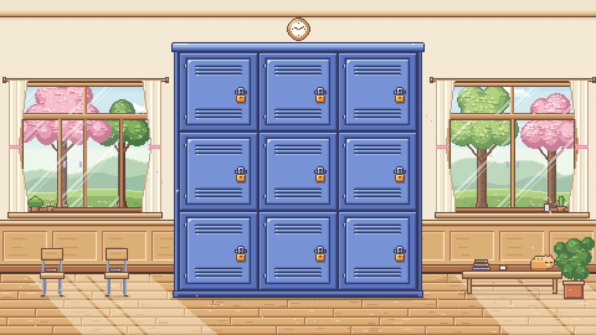

# homeroom ✿

**Find your people in a big school.** Every day you get a 3×3 grid of "locker neighbors" matched on something you have in common. Peek inside their lockers to get a glimpse of who they are, and leave a low-stakes note if someone catches your eye. If they accept, a DM opens up.

Built for DiversaTech's *Build Something AI Cannot Do Alone @ Cal* hackathon.



## Try the prototype

Open `index.html` in a browser for the self-contained prototype, or run the local demo with [Bun](https://bun.sh) to enable Spotify song search:

```sh
GLASSER_API_KEY_FILE='/path/to/glasser api.txt' bun server.ts
```

Open [localhost:4173](http://localhost:4173/). No package installation is needed. Use `--port=4174` to choose another port. You can also inject `GLASSER_API_KEY` at runtime instead of using a file. Keep credential files outside this repository.

The server reads the key privately and calls Glasser's ScrapeCreators Spotify search endpoint. Searches run on submit; identical queries share an in-flight request and a ten-minute memory cache. API searches spend the connected Glasser balance. It plays best on a laptop-sized screen.

The prototype covers the first flow:

1. **Hallway:** today's 8 locker neighbors plus your own locker in the middle. Hover a locker and Mochi the hall cat tells you whose it is.
2. **Open a locker:** the door swings open. The owner's profile card is pinned inside the door, and their items sit in the locker.
3. **Hover items:** each photo, sticker or object shows the owner's description in a video-game dialogue box.
4. **Like or leave a note:** a lined-paper note with quick-start compliments drawn from that locker.
5. **Send:** an envelope animation, then the note shows up under mailbox → sent.
6. **Mailbox:** accept a received note to open a DM.

All people in the prototype are made-up examples.

### Onboarding, quiz and notes (`src/flows.template.html`)

Opening the page now starts at sign-in. Add `#hallway` to the URL to skip straight to the hallway with an example profile.

1. **Sign in:** `@berkeley.edu` email only → mock magic-link inbox → optional friend invite.
2. **Make your locker · about you:** the form sits on the inside of your locker door (name, pronouns, major, year, MBTI, likes, classes, food spot, study spot, hobbies, artist, fun fact). Major / MBTI / year / first hobby become door tags. Below that is the theme picker: 14 interior wallpapers × 5 exterior colors, plus a door sticker. "✨ fill example" fills everything in for a demo.
3. **Sprite maker:** click your circle. Tabs for face (eyes, mouth, skin, blush), hair (9 styles + any color), shirt and background, plus a "surprise me" button. It's drawn at 24×24 in the same style as the other avatars.
4. **Decorate:** drag photos, stickers and objects into your locker. Click a placed item to give it a title and description and to resize, rotate, flip or remove it. Drag an item out of the locker to remove it. Objects settle onto the shelf or the floor. **Upload** turns any photo into a pixel polaroid (3 sizes) or any image into a die-cut sticker. The **music cassette** is the first object in the bottom tray. Click it or drag it into the locker to open Spotify search: select a result, add an optional caption, then choose **Pin song to locker**. The cassette uses the same drag, resize, rotate, flip, and remove controls as the other objects. Click the placed cassette to select its settings, change the song, or listen.
5. **Go live:** your locker shows up in the hallway, and the **daily quiz** pops up (multiple choice or write your own). Today's answer decides tomorrow's neighbors.
6. **Past quizzes** (clipboard button): a 3×3 grid of past questions and your answers.
7. **Notes:** every note opens a DM by default. Unviewed notes poke out of your locker's vent. Click your locker (or press →) to unfold them one by one, or see all new ones in a grid. Once a note is viewed it leaves your locker and the notes grid and lives only in your DMs (mailbox → DMs).

The pencil buttons (top bar, and "edit locker" inside your own locker) reopen the editor.

The song, caption, position, and transforms are saved in this browser's local storage independently of the other demo profile fields. Use **♫ change song** in the selected cassette's settings to replace the song; Cancel discards changes in the music dialog. Remove it with the object's trash control or drag it out of the locker. In the saved locker, click the cassette to open Spotify's official player in a separate dialog. Closing the player returns to your locker or unsaved music draft. Spotify controls playback availability, including previews, login, and account or region restrictions; the demo does not download or serve audio.

## Repo layout

```
index.html                 built prototype (generated, open this)
server.ts                  local Bun server and private Glasser search endpoint
src/index.template.html    page source: hallway layout, styles, interactions, example data
src/flows.template.html    sign-in, locker editor, sprite maker, daily quiz, notes
src/music.js               music editor, official embed, and local song storage
src/music.css              paper editor and locker music shelf styles
art/                       pixel-art generators (Python + Pillow)
  hallway.py               hallway background (480×270)
  assets.py                locker skins, big doors, interiors, items, avatars, icons
  locker_tile.py           seamless 64px locker tile
  locker_standalone.py     standalone 64px locker sprite
  build.py                 bakes art/assets into src → index.html
  assets/                  generated sprites
exports/                   full-size PNGs for slides and Figma
```

## Editing

- **Change neighbors, items or descriptions:** edit the `PEOPLE` list in `src/index.template.html`, then run `python3 art/build.py`.
- **Change the music editor:** edit `src/music.js` or `src/music.css`, then run `python3 art/build.py`. The generator embeds both files into `index.html`.
- **Redraw the art:** from `art/`, run
  ```sh
  pip install pillow
  python3 assets.py                                  # sprites → art/assets/
  python3 flow_assets.py                             # editor wallpapers, quiz icon, note sprite
  NOCLOCK=1 python3 hallway.py hallway_noclock       # background used by the page
  python3 build.py                                   # → ../index.html
  ```
  `python3 hallway.py hallway` makes the version with the wall clock.

Everything is drawn at 1 art pixel = 1 stage pixel on a 480×270 stage, then scaled to fit the window with `image-rendering: pixelated`. At 1920×1080, locker tiles are 256 px and the 3×3 grid starts at (576, 168).

## Palette

Soft sage, cream and warm wood, with deep warm-brown outlines (`#6e4a3c`) instead of black. Lockers use 6-step ramps (blue, pink, mint, butter, lavender), defined in `art/assets.py`.
